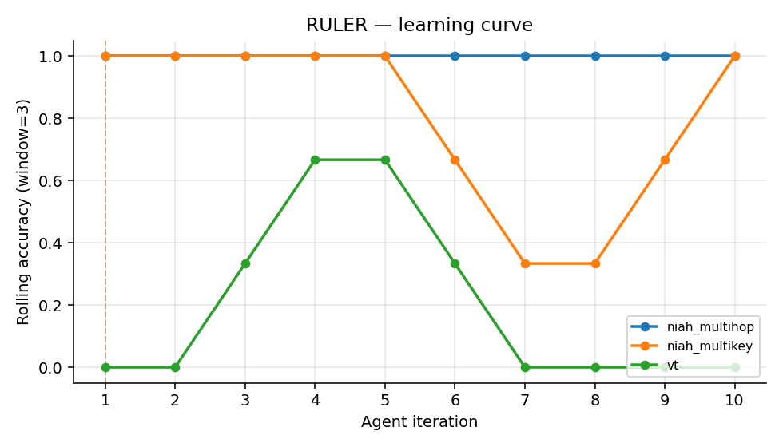
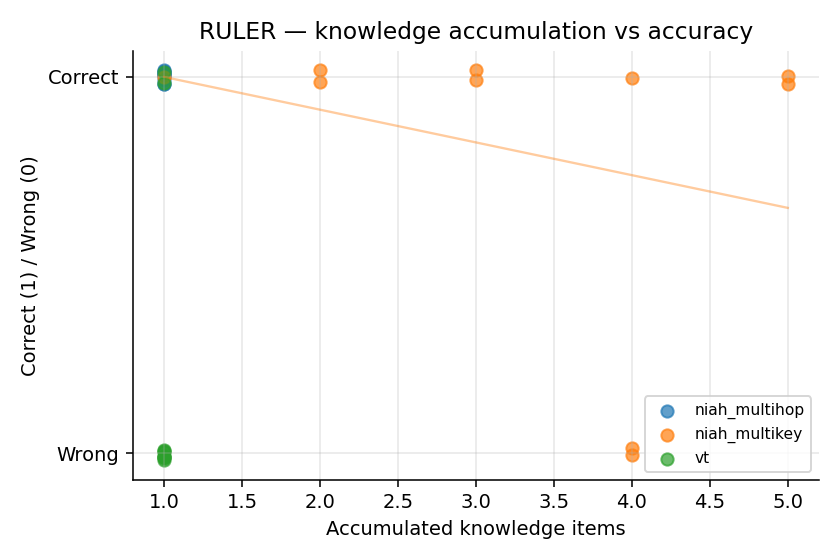
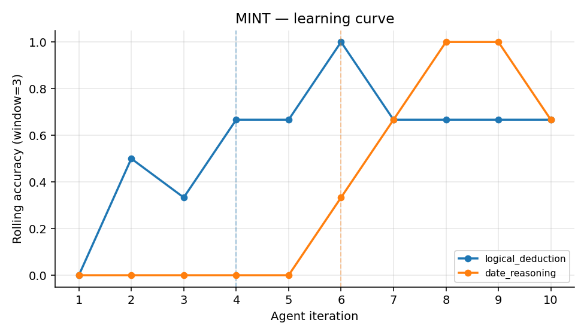
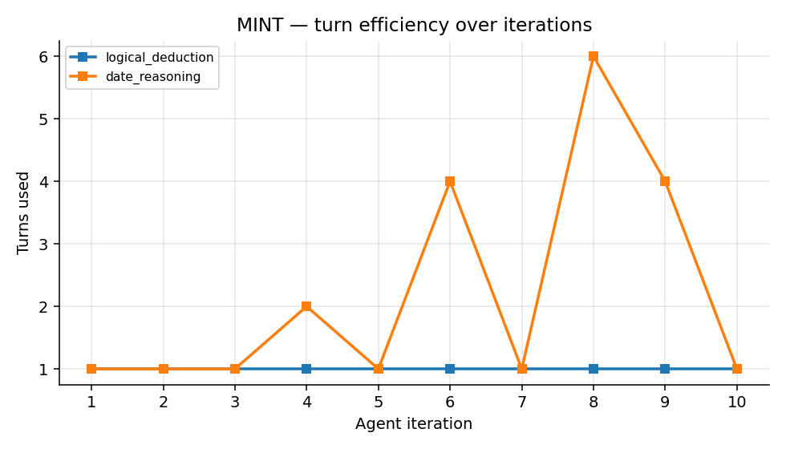
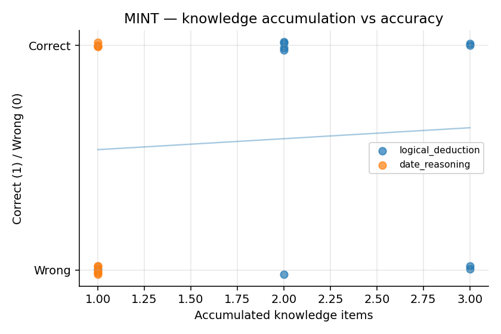
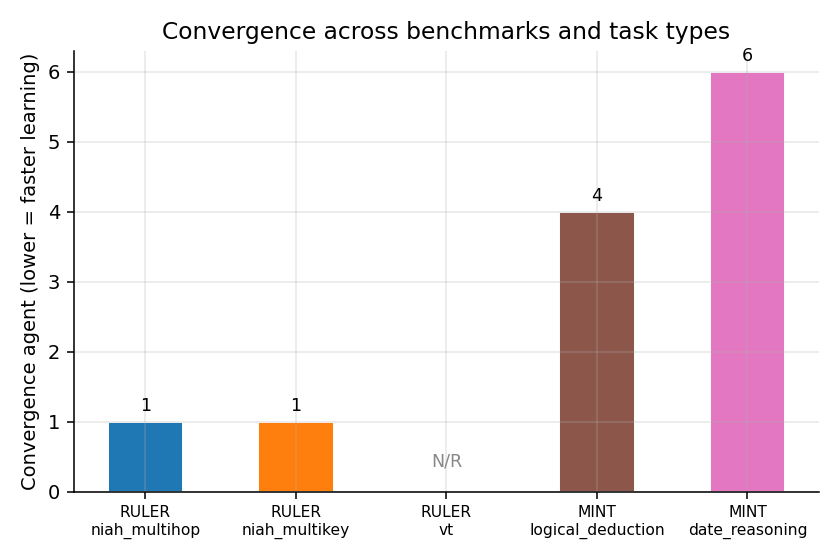

# Iterative Educability Benchmarking: RULER & MINT

**Date:** 2026-04-29  
**Model:** llama3:8b (local, via Ollama)  
**Experiment:** Do agents learn from distilled strategy knowledge passed by prior agents?

---

## 1. Overview

This experiment tests **model educability** — whether a model can improve at a task by receiving
procedural knowledge distilled by earlier agents that attempted the same task class.

The design is deliberately adversarial to memorisation: each agent receives a **fresh task
instance** (different random seed → different content, values, and structure), so sharing the
specific answer is impossible. What accumulates across agents is **strategy knowledge** — verbal
descriptions of *how* to approach the task — extracted after each attempt and filtered for
near-duplicate content (Jaccard similarity ≥ 0.55) before being passed forward.

**Convergence** is defined as the first agent of a run of three consecutive correct answers.

---

## 2. Benchmarks

### 2.1 RULER

> Hsieh, C.-P. et al. (2024). **RULER: What's the (Real) Context Window of Your LLM?**
> *arXiv:2404.06654*. [https://arxiv.org/abs/2404.06654](https://arxiv.org/abs/2404.06654)

RULER evaluates long-context language models through synthetic tasks where the correct answer
is injected at controlled positions in a document of controlled length. Core task families:

| Family | Description |
|--------|-------------|
| NIAH (Needle-in-a-Haystack) | Retrieve a specific fact from a long document |
| Variable Tracking (VT) | Trace arithmetic state through a chain of updates |
| Common/Frequent Word Extraction | Identify statistically dominant tokens |

This experiment uses three hard variants:

- **`niah_multihop`** — 3-hop chain: needle A names vault X, needle B says X mirrors Y,
  needle C gives Y's value. All three must be found and connected.
- **`niah_multikey`** — 5 key-value pairs + one distractor whose key differs from the
  target by exactly one character, placed 15–25 words after the correct pair.
- **`vt`** — 6 variables, 15 update steps, operators include `+`, `−`, and `×`.
  Initial values are stated once at the top; cross-variable assignments use current values
  at the moment of the update.

### 2.2 MINT

> Wang, X. et al. (2023). **MINT: Evaluating LLMs in Multi-turn Interaction with Tools and Language Feedback.**
> *arXiv:2309.10691*. [https://arxiv.org/abs/2309.10691](https://arxiv.org/abs/2309.10691)

MINT measures whether agents benefit from **multi-turn interaction** with tools. In each turn
the model may invoke a Python interpreter (wrapping code in ` ```python ... ``` `); it submits
a final answer via `FINAL ANSWER: <value>`. Tasks come from BIG-Bench Hard (Suzgun et al., 2023):

> Suzgun, M. et al. (2023). **Challenging BIG-Bench Tasks and Whether Chain-of-Thought Can Solve Them.**
> *arXiv:2210.09261*. [https://arxiv.org/abs/2210.09261](https://arxiv.org/abs/2210.09261)

Two task types are used:

- **`logical_deduction`** — 6-element ordering puzzles from a set of relational constraints.
  Requires systematic constraint propagation rather than pattern matching.
- **`date_reasoning`** — Multi-step chained date arithmetic (nth-weekday lookups,
  event chains, day-of-year counts, day-of-week shifts). Python's `datetime` module
  gives exact answers where mental arithmetic fails.

---

## 3. Results

### 3.1 RULER Summary

| Task | Accuracy | Convergence Agent |
|------|----------|-------------------|
| `niah_multihop` | 100% | 1 |
| `niah_multikey` | 80% | 1 |
| `vt` | 20% | not reached |





#### `niah_multihop` — 100%, trivially solved

Every agent answered correctly from agent 1 onwards. A single strategy was generated
by agent 1 and all subsequent strategy extractions were blocked as near-duplicates, so
the knowledge list stayed at K=1 throughout. The model locates and chains 3-hop needle
sentences natively at the context lengths tested (1K–8K tokens), without any guidance.

**Implication:** At these context lengths, multi-hop retrieval is within the model's
base capability. This task needs either longer contexts (32K+) or deeper chains (4-hop)
to produce a learning signal.

#### `niah_multikey` — 80%, context-length failure pattern

Agents 6 and 7 failed; all others succeeded. Cross-referencing with the random seeds,
agents 6–7 received the largest context instances (8K tokens). The distractor pair
(one-character key difference) did not cause failures — the task-specific strategies
that emerged specifically address it:

> *"I carefully examined each key-value pair, reading character-by-character to identify
> potential matches... without being misled by the distractor pair."* — Agent 1

> *"I should have read each key character-by-character in parallel, comparing multiple
> characters simultaneously..."* — Agent 6 (post-failure)

These are qualitatively better strategies than the previous run, which produced generic
"scan the document" advice. However, they did not prevent the context-length failures,
which appear to be a retrieval ceiling rather than a strategy problem.

#### `vt` — 20%, knowledge plateau

Only agents 3 and 4 answered correctly (20% accuracy); convergence was never reached.
The strategy list stalled at K=1 for the entire run — agent 1 generated one strategy,
and all 9 subsequent extractions were blocked as Jaccard-similar:

> *"I should have iteratively applied each update operation in sequence, carefully
> considering the current values of all variables at each step..."* — Agent 1 (only stored strategy)

The correct answer to agents 3 and 4 appears to be luck within that instance rather than
strategy-driven improvement, as no new knowledge was added after agent 1.

**Core diagnosis:** Verbal strategy descriptions cannot encode the simulation algorithm
that VT requires. The model correctly identifies the concept ("iterate in order, track
current values") but cannot reliably execute it across 15 steps with 6 variables and
mixed operators. This is a **procedural execution failure**, not a strategy acquisition failure.

---

### 3.2 MINT Summary

| Task | Accuracy | Avg Turns | Convergence Agent |
|------|----------|-----------|-------------------|
| `logical_deduction` | 60% | 1.0 | 4 |
| `date_reasoning` | 40% | 2.2 | 6 |







#### `logical_deduction` — 60%, unstable convergence

Convergence was reached at agent 4 (agents 4–6 correct), but the model failed again at
agents 7 and 10. All agents used exactly 1 turn — the Python interpreter was never invoked
for this task type. The model approached every problem via language reasoning alone.

Strategy distillation produced substantively correct guidance:

> *"...a systematic application of relational constraints, starting with assigning known
> anchor positions and then propagating information to fill remaining slots through logical
> deduction."* — Agent 2

Despite this, agents continued to fail. The strategy describes the right method, but the
model is inconsistent in executing 6-element constraint chains in a single reasoning pass.
The absence of tool use is notable: code (e.g., itertools.permutations + constraint checking)
would guarantee correctness but was never attempted.

#### `date_reasoning` — 40%, strong multi-turn signal

This is the most interpretable result. There is a clear correlation between turns used and
correctness:

| Agent | Turns | Correct | Notes |
|-------|-------|---------|-------|
| 1 | 1 | ✗ | Off by 6 days (manual arithmetic) |
| 2 | 1 | ✗ | Wrong by ~1 month |
| 3 | 1 | ✗ | Day-of-week: "Sunday" vs "Thursday" |
| 4 | 2 | ✗ | Off by ~2 months |
| 5 | 1 | ✗ | Off by 1 (forgot leap year) |
| 6 | 4 | ✓ | Used Python datetime |
| 7 | 1 | ✓ | Simple Fridays-in-year count |
| 8 | 6 | ✓ | Used Python datetime iteratively |
| 9 | 4 | ✓ | Used Python datetime |
| 10 | 1 | ✗ | Off by 9 days |

Agents that used 4–6 turns (Python code) succeeded; agents that attempted the calculation
mentally in a single turn failed. The correct strategy ("use Python datetime") was distilled
by agent 1 but appears as K=1 throughout — only one unique strategy was generated, yet it
was sufficient to eventually change behaviour.

Agent 10's failure despite being in a "post-convergence" run is characteristic: the task
rotated to a new problem (25-day subtraction) which the model answered in 1 turn without
code, reverting to the error pattern.

---

### 3.3 Convergence Comparison



---

## 4. Analysis

### 4.1 Retrieval vs Procedural Tasks

The clearest finding across both benchmarks is a **retrieval–procedure asymmetry**:

- **Retrieval tasks** (NIAH variants): the model handles these natively; verbal strategies
  do not add measurable value because the task does not require learning a new algorithm.
- **Procedural tasks** (VT, logical_deduction): verbal strategies correctly identify the
  algorithm in abstract ("iterate in order", "propagate constraints") but cannot reliably
  guide execution across many steps. The model understands the strategy but cannot apply it
  consistently.

### 4.2 Strategy Quality vs Strategy Applicability

Strategies in the current run are qualitatively better than in early runs — they are
task-specific (mention "character-by-character", "current values at each step",
"assign anchors first") rather than generic ("scan the document", "be systematic").
But improved strategy quality did not reliably improve accuracy on procedural tasks.

This suggests a gap between **strategy comprehension** and **strategy execution** that
verbal distillation alone cannot bridge. A model can hold the correct procedure in its
context window and still fail to apply it for 15+ sequential operations.

### 4.3 Tool Use as a Strategy Proxy

The `date_reasoning` results show that the most effective "strategy" a prior agent can
pass is not a verbal description but an implicit one: *use the tool*. Agents 6–9 succeeded
because they invoked Python rather than reasoning mentally. The distilled strategy
("use datetime and timedelta") correctly identifies this, but agents 2–5 did not follow
it — they attempted single-turn mental arithmetic instead.

This points to a deeper problem: **strategy transfer requires the receiving agent to trust
and act on the strategy**, not merely receive it. An agent that is confident in its own
reasoning will default to that even when told not to.

### 4.4 Knowledge Plateau

VT kept K=1 throughout the entire run. The deduplication filter (Jaccard ≥ 0.55) correctly
blocked near-identical entries, but this revealed that the model's metacognitive vocabulary
for procedural tasks is narrow — it regenerates the same conceptual description regardless
of whether the previous attempt succeeded or failed.

For procedural tasks, a more effective distillation signal might be a structured trace
(a step-by-step worked example of the correct procedure for the previous instance) rather
than a verbal strategy sentence.

---

## 5. Limitations

- **Model capability ceiling:** llama3:8b is near its limit on VT and date_reasoning.
  Some failures are not strategy failures but model failures — the agent genuinely cannot
  execute 15-step arithmetic regardless of guidance.
- **Context length:** NIAH failures at 8K tokens are retrieval failures, not learning failures.
  The experiment cannot distinguish these without isolating context length as a variable.
- **Single-agent per iteration:** Each agent is stateless. There is no within-agent learning,
  only cross-agent strategy accumulation. This models one-shot deployment, not fine-tuning.
- **Strategy extraction quality:** The metacognitive prompt produces useful but abstract
  strategies. A richer extraction format (e.g., step traces, worked examples) would likely
  yield stronger transfer, particularly for procedural tasks.

---

## 6. Next Steps

1. **VT:** Replace verbal strategy extraction with a structured trace format — the correct
   step-by-step execution of the previous instance, presented as a worked example.
2. **niah_multihop:** Scale to 32K+ token contexts, or extend to 4-hop chains.
3. **logical_deduction:** Prompt agents to use Python (enumerate permutations, check constraints)
   rather than purely verbal reasoning.
4. **Ablation:** Run each task with *no* accumulated knowledge to establish a baseline
   and measure the actual delta attributable to strategy transfer.

---

*Run `python analyze.py` from this directory to regenerate plots from the latest result files.*
