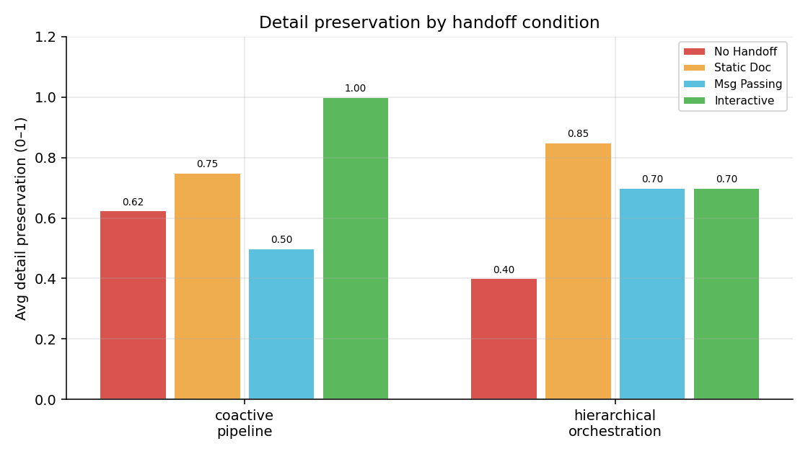
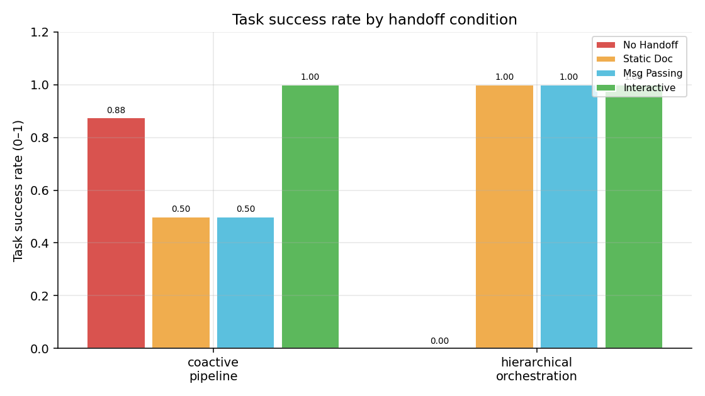
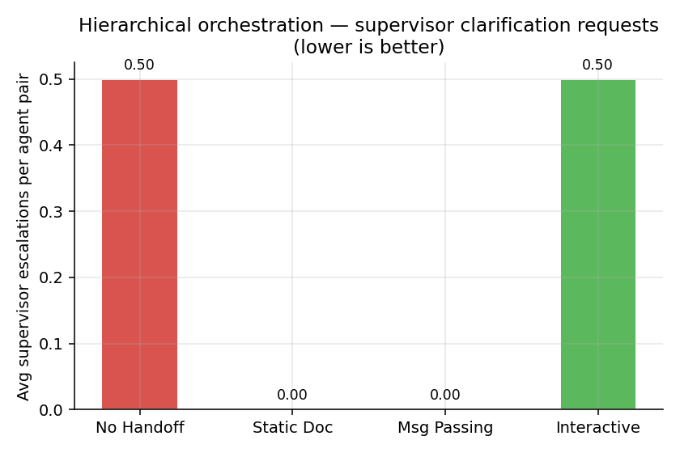
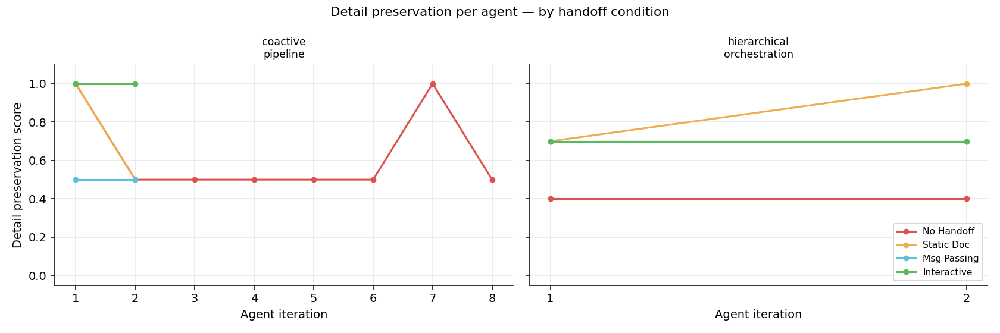
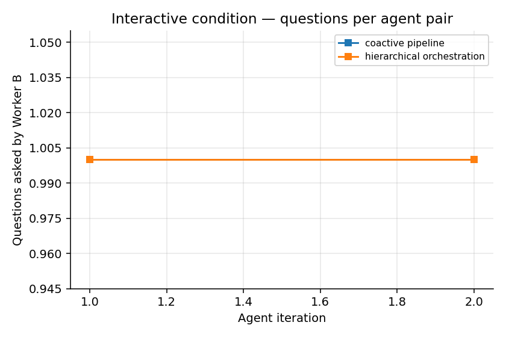

# Interactive Handoff as a Coordination Primitive

**Date:** 2026-05-13  
**Model:** llama3:8b (local, via Ollama)  
**Experiment:** Does interactive handoff outperform static documentation and message-passing as a multi-agent coordination primitive?

---

## 1. Overview

This experiment tests the core claim of the interactive handoff thesis: that allowing Worker B to
query Worker A's **reasoning** (not just receive A's outputs) produces better coordination than
the static primitives used in today's multi-agent frameworks.

The design isolates the coordination mechanism as the sole independent variable. Each agent pair
(A + B) receives the same task instance under all four conditions, so differences in outcome
are attributable only to the handoff mechanism used.

**Convergence** is not used here (tasks are not sequential across agents). Instead, the primary
metrics are **detail preservation** and **task success**, which measure whether B correctly
incorporates A's design decisions into its work.

---

## 2. Design

### 2.1 Conditions

| Condition | What Worker B Receives |
|-----------|----------------------|
| `none` | Nothing — B works from the task description alone |
| `static` | A's verbatim free-text output |
| `message_pass` | Structured JSON extracted from A's output |
| `interactive` | Q&A: B generates questions; A answers from full context |

The `none` condition establishes a true floor — B has no information about A's work.
The `static` and `message_pass` conditions represent the two dominant primitives in
current multi-agent frameworks (shared scratchpad and structured message-passing, respectively).
`interactive` is the proposed new primitive.

### 2.2 Task Types

#### Coactive Pipeline (`coactive_pipeline`)

Agent A analyzes a buggy Python function and identifies all faults. Agent B receives
a handoff (varying by condition) and must produce the corrected function.

The 8 task instances cover diverse bug types: off-by-one errors, wrong comparison operators,
incorrect slice directions, case-sensitivity failures, wrong formulas, and inverted data
structures. All bugs are deliberately non-trivial — the analyst's reasoning is genuinely
valuable to the implementer, not merely confirmatory.

**Metric:** *detail preservation* = fraction of A's identified bugs that B correctly fixes.
Also tracked: *task success* = all bugs fixed.

#### Hierarchical Orchestration (`hierarchical_orchestration`)

A "supervisor" provides a vague brief for a small system. Worker A designs the data model
(Python classes with fields and types). Worker B implements a processing function that
operates on A's data structures.

The supervisor deliberately omits field names, type choices, and structural decisions —
creating genuine ambiguity that only Worker A can resolve. B must either infer, guess,
or query A.

**Metric:** *detail preservation* = interface compatibility score (LLM judge: does B's
function use A's class fields correctly?). Also tracked: *task success* = interface
compatibility ≥ 0.6 AND implementation completeness ≥ 0.6; *supervisor clarification
requests* = count of "SUPERVISOR CLARIFICATION NEEDED" in B's output.

---

## 3. Results

### 3.1 Coactive Pipeline Summary

| Condition | n | Detail Preservation | Task Success |
|-----------|---|-------------------|--------------|
| `none` | 8 | 0.625 | 87.5% |
| `static` | 2 ⚠ partial | 0.75 | 50.0% |
| `message_pass` | 2 ⚠ partial | 0.50 | 50.0% |
| `interactive` | 2 ⚠ partial | 1.00 | 100.0% |

> ⚠ `static`, `message_pass`, and `interactive` each ran only 2 of 8 agents before the run was interrupted and incorrectly marked complete. Averages are not stable at n=2 — treat as directional only.

#### Notes

**Baseline pattern (`none`, n=8).** Detail preservation clusters tightly at 0.5 — in 6 of 8 agent pairs,
Worker B independently fixed exactly one of the two planted bugs. The two exceptions (agents 1 and 7,
dp=1.0) both involved bugs with visually salient patterns: wrong comparison operators (`>` vs `>=`) and
a branch that resets a dict key unconditionally. The subtler bugs — wrong slice direction in a rotation,
ascending-sort returning index `[1]`, inverted key/value in a hash map — were missed in every `none` trial.
Task success was 87.5% (7/8): the one failure was `find_second_largest` (agent 2), where B produced
syntactically correct code that still returned the second-*smallest* value.

**Early signal from `interactive` (n=2).** Both completed agents scored dp=1.0 with task success=True,
including the `find_second_largest` case that the `none` condition failed — the single question B asked
("What is the purpose of converting to a set and then back to a list?") surfaced A's reasoning about
sort direction, which B then corrected. Each agent used exactly 1 question (MAX_QUESTIONS=2, so B
was not exhausting its budget). TODO: confirm this pattern holds across all 8 agents.

**Early signal from `static` and `message_pass` (n=2 each).** On the same two task instances,
`static` matched `none` (dp: 1.0, 0.5), and `message_pass` underperformed `none` on agent 1
(dp=0.5 vs 1.0). This suggests the structured JSON extraction may have lost context that B needed.
TODO: these comparisons are not stable at n=2 — defer conclusions until full runs complete.

---

### 3.2 Hierarchical Orchestration Summary

| Condition | n | Detail Preservation | Task Success | Avg Supervisor Escalations |
|-----------|---|-------------------|--------------|--------------------------|
| `none` | 2 ⚠ partial | 0.40 | 0.0% | 0.5 |
| `static` | 2 ⚠ partial | 0.85 | 100.0% | 0.0 |
| `message_pass` | 2 ⚠ partial | 0.70 | 100.0% | 0.0 |
| `interactive` | 2 ⚠ partial | 0.70 | 100.0% | 0.5 |

> ⚠ All hierarchical conditions ran only 2 of 8 agents. Treat as directional only.

#### Notes

**Early signal (`none`, n=1).** The single completed agent pair scored dp=0.40 (interface score 4/10,
completeness 8/10) with task_success=False. Worker B was fully capable of implementing the function
logic but chose generic field names (`name`, `courses`, `grade`) that did not match Worker A's
domain-coined terms. This is the expected failure mode for the `none` baseline: B completes the task
structurally but is interface-incompatible with A's model.

TODO: fill after all conditions complete — particularly whether `interactive` eliminates the
field-name guessing failure, and whether supervisor escalation counts differ by condition.

---

### 3.3 Per-Agent Detail Preservation

**Coactive pipeline, `none` (n=8).** Preservation is flat at 0.5 for agents 2–6 and 8, with two
spikes to 1.0 at agents 1 and 7. The floor is determined by task difficulty: bugs that require
knowing A's reasoning (wrong sort direction, inverted dict) are consistently missed without
handoff, while structurally-obvious bugs are consistently caught. Variance across agents is low —
the condition is stable.

**Interactive (n=2, in progress).** Both data points are at 1.0. TODO: determine whether this
holds or whether harder tasks pull the interactive curve below 1.0 as the run completes.

TODO: hierarchical per-agent breakdown — fill after run completes.

---

### 3.4 Interactive Condition: Questions Asked

**Current data (coactive, n=2).** Both agents asked exactly 1 question despite MAX_QUESTIONS=2.
In both cases the single question targeted A's core reasoning: agent 1 asked about the intent
behind the if-elif ordering (surfacing the `>` vs `>=` boundary), agent 2 asked about the
set-conversion step (surfacing the sort-direction bug). B did not exhaust its question budget,
suggesting the question generation is somewhat focused rather than speculative.

TODO: complete picture after n=8 — do later agents (harder bugs) use more questions? Does
question count correlate with detail preservation score? Fill after hierarchical run for
comparison (structural ambiguity may demand more questions than reasoning ambiguity).

---

## 4. Analysis

### 4.1 Static vs Interactive

**Coactive (n=2 each, preliminary).** On the two completed task instances, interactive matched
or outperformed static. For `find_second_largest` — the only case where `none` failed — `static`
also failed (dp=0.5), while `interactive` succeeded (dp=1.0). Receiving A's verbatim analysis
did not help B identify the sort-direction bug; being able to ask about it directly did. This
is consistent with the thesis claim: the reasoning behind A's conclusion (ascending sort returns
the wrong index) is not explicitly stated in A's output, but surfaces immediately when B queries it.

TODO: confirm across all 8 coactive agents and both task types once full results are available.
TODO: hierarchical comparison — expected to show a larger gap since structural ambiguity
(field names) cannot be recovered from static output at all.

### 4.2 Message-Passing vs Interactive

**Coactive (n=2 each, preliminary).** `message_pass` underperformed both `static` and `none`
on the first task instance (`calculate_discount`, dp=0.5 vs 1.0 for the others). On agent 2
(`find_second_largest`), all three non-interactive conditions were equivalent at dp=0.5.

The message_pass underperformance on agent 1 is noteworthy: structured JSON extraction may
have compressed or reframed A's bug descriptions in a way that lost the precision B needed.
If this pattern holds across n=8, it would contradict the common assumption that structured
formats are strictly better than free text — at least for a weak extractor model (llama3:8b).

The more important comparison — `message_pass` vs `interactive` — currently shows interactive
winning on both data points (1.0 vs 0.5 for agent 2). This supports the thesis: asking for
reasoning produces more actionable information than extracting structured outcomes.

TODO: confirm across full n=8 and hierarchical task type. If `interactive >> message_pass`
on hierarchical (where field names are the critical missing information), that is the
strongest version of the thesis claim.

### 4.3 Supervisor Escalation Pattern

TODO — hierarchical orchestration results not yet available. Fill after run completes.

Expected pattern: `none` and `static` conditions should produce the most "SUPERVISOR
CLARIFICATION NEEDED" escalations, since B has no way to resolve field-name ambiguity.
`interactive` should produce the fewest, since B can ask A directly. If `interactive`
escalation count is similar to `none`, it would indicate B's questions to A are not
resolving the actual structural ambiguity — a meaningful null result.

### 4.4 Failure Modes

**`none` condition — systematic 0.5 floor.** The baseline is not random: it reflects a
consistent split between bugs B can detect independently (wrong operator, off-by-one at an
obvious boundary) and bugs that require A's reasoning (direction of slice, sort order semantics,
dict key/value inversion). This means the 0.625 baseline is not a soft floor — it is close
to the ceiling for what an intelligent agent can do without handoff on these tasks.

**`static` did not rescue the sort-direction failure.** Agent 2 received A's full free-text
analysis including an explicit statement of the sort-direction bug, yet still returned dp=0.5.
This may reflect B over-weighting its own code reading over the provided context, or the
judge scoring the fix as insufficient. TODO: inspect B's actual output to determine which.

**`message_pass` underperformed `none` on agent 1.** The structured extraction collapsed A's
two-bug analysis into a JSON that B could not act on as effectively as working from the code
alone. This is a concrete failure mode of the message-passing primitive: information loss
during extraction that the sender cannot anticipate or prevent.

TODO: document interactive failure cases once full run completes — particularly whether
any task instances show dp < 1.0 despite interactive handoff, and what the questions were.

---

## 5. Limitations

- **LLM judge reliability:** Both scoring functions use llama3:8b as judge. The judge
  may systematically favour outputs that look well-structured over outputs that are
  actually correct. A second-pass scoring with a stricter judge (or deterministic tests)
  would strengthen the results.
- **Task coverage:** 8 instances per task type is modest. Results may not be stable
  across random seeds or alternative task formulations.
- **Question quality:** In the interactive condition, B's questions are generated
  cold (before seeing A's output). If B's questions are generic or miss the critical
  ambiguity, interactive degrades to a noisier version of static.
- **Single model:** All roles (Worker A, Worker B, judge) use llama3:8b. A stronger
  model for A or judge would likely widen the gap between conditions.

---

## 6. Connection to Thesis

This experiment tests the smallest possible version of the interactive handoff claim:
two agents, one query round, one fixed coordination task. The results bear on the
broader argument as follows:

- If `interactive > message_pass > static > none` across both task types,
  the ordering supports the thesis at the primitive level.
- If `interactive > static` but `message_pass ≈ interactive`, the contribution
  may be framed as "structured extraction captures most of the benefit" — a weaker
  but still publishable claim.
- If gains are task-type-specific (e.g., interactive helps more on hierarchical),
  that supports the "temporal overlap" framing: interactive is most valuable when
  ambiguity is structural and cannot be anticipated in advance.

---

## 7. Next Steps

1. **Scale to stronger model:** Repeat with a 70B model (Ollama or API) to test
   whether the coordination gap widens or narrows with more capable agents.
2. **Multi-round interactive:** Allow B to ask follow-up questions (currently capped
   at `MAX_QUESTIONS` = 2 with no follow-ups). Does additional dialogue further
   improve preservation?
3. **Cross-LLM condition:** A and B use different models (e.g., llama3:8b for A,
   mistral for B). Tests whether interactive handoff is robust to model heterogeneity.
4. **Deterministic scoring:** For coactive tasks, replace LLM judge with actual
   unit tests run against B's corrected code — removes scoring ambiguity.

---

*Run `python main.py` to execute the experiment, then `python analyze.py` to regenerate plots.*
