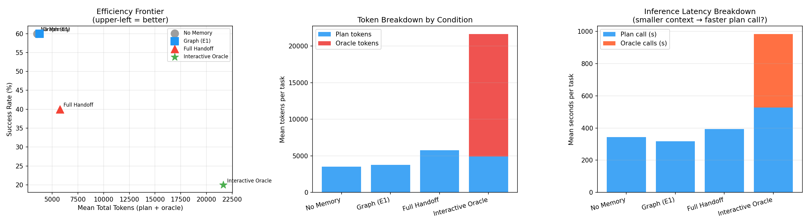

# E3: Interactive Session Querying for Knowledge Transfer

**Date:** 2026-07-01 (run4, normalized CPU rerun: 2026-07-03)
**Model:** llama3:8b (local, via llama-server CPU, 10 threads, i7-8750H)
**Experiment:** Does demand-driven interactive querying of a prior agent session achieve
better cost-efficiency than static knowledge transfer?

---

## 1. Overview

This experiment addresses a specific failure mode of the E1 graph memory controller: lossy
upfront distillation. Compressing trajectories into a procedural graph necessarily discards
detail and commits to a fixed representation before seeing what the student agent actually
needs to know. E3 tests whether *demand-driven querying* — letting the student ask targeted
questions before planning — achieves better task performance at lower token cost.

The design pits four conditions against each other on the same student tasks:

| Condition | What student receives before planning |
|---|---|
| `no_memory` | Nothing — cold start baseline |
| `graph_session` | K-hop subgraph injection (E1 retrieval infrastructure) |
| `full_handoff` | All 5 teacher trajectories prepended to the system prompt |
| `interactive_oracle` | Up to K=5 targeted Q&A turns with an LLM oracle loaded with teacher trajectories |

**Primary hypothesis:** Interactive querying achieves ≥ full-handoff success rate at
significantly lower total token cost (demand-driven selection beats bulk injection).

**Benchmark:** TravelPlanner (validation split, hard tasks only). Teacher: val_000–val_004.
Student: val_005–val_009. Non-overlapping task slices; the oracle's knowledge must
generalise, not recall.

---

## 2. Design

### 2.1 Teacher Phase

A single teacher session runs val_000–val_004. For each task the teacher generates a
travel plan, receives evaluator feedback, and the full trajectory is recorded as:

```
QUERY: <task description>
REFERENCE (excerpt): <first 2000 chars of reference data>
PLAN: <generated plan>
EVAL: success=<bool>, feedback=<200-char excerpt>
```

These five trajectories are the shared knowledge artifact for all knowledge-transfer conditions.

### 2.2 Conditions

**`no_memory`**: Student receives the task and reference data only. Baseline.

**`graph_session`**: Teacher trajectories are consolidated into a `ProcedureGraph` (39 nodes).
Before planning, a `ContextInjector` runs k-hop retrieval (k=2, top-5 seeds, 2000-token
budget) from the student task description and injects the resulting subgraph as a memory block.

**`full_handoff`**: The oracle's `format_all_trajectories()` method concatenates all five
trajectories (up to 8000 characters) and prepends them to the planning system prompt. The
student sees everything the teacher did, in order.

**`interactive_oracle`**: A `SessionOracle` LLM instance is loaded with all five teacher
trajectories. Before planning, the student executes K=5 Q&A rounds: each round calls
`generate_question()` (student LLM proposes the next question given task + prior answers)
then `oracle.ask()` (oracle LLM answers from teacher records). The resulting Q&A block
replaces the memory block. Each oracle call is stateless — the oracle has no memory of
prior questions in the same task, forcing well-formed targeted questions.

### 2.3 Evaluation

TravelPlanner's built-in evaluator checks hard constraints: flight validity, restaurant
and hotel existence, accommodation on non-return days, budget compliance, and cuisine/
room-type/smoking constraints. A plan is `success=True` only when all constraints pass.

Primary metrics:
- **success_rate**: Does the condition help at all?
- **tokens_per_successful_task**: Primary efficiency metric — total tokens / successful tasks
- **mean_total_elapsed_s**: Wall-clock cost per task (all conditions on same CPU backend)

---

## 3. Results

### 3.1 Condition Comparison

| Condition | Success Rate | Mean Total Tokens | Mean Plan Tokens | Mean Oracle Tokens | Tok/Success | Oracle Qs |
|---|---|---|---|---|---|---|
| No Memory | **60.0%** | 3,537 | 3,537 | 0 | 5,895 | 0.0 |
| Graph (E1) | **60.0%** | 3,764 | 3,764 | 0 | 6,273 | 0.0 |
| Full Handoff | 40.0% | 5,743 | 5,743 | 0 | 14,358 | 0.0 |
| Interactive Oracle | 20.0% | 21,639 | 4,926 | 16,713 | **108,193** | 5.0 |

### 3.2 Efficiency (Tokens per Successful Task)

| Condition | Success | Tok/Success | vs no_memory |
|---|---|---|---|
| No Memory | 60% | 5,895 | 1.00× |
| Graph (E1) | 60% | 6,273 | 1.06× |
| Full Handoff | 40% | 14,358 | 2.44× |
| Interactive Oracle | 20% | 108,193 | **18.35×** |

### 3.3 Latency (normalized, same CPU backend)

| Condition | Plan call (s) | Oracle calls (s) | Total (s/task) | vs no_memory |
|---|---|---|---|---|
| No Memory | 344 | 0 | 344 | 1.00× |
| Graph (E1) | 318 | 0 | 319 | 0.92× |
| Full Handoff | 394 | 0 | 395 | 1.15× |
| Interactive Oracle | 526 | 457 | 984 | **2.86×** |

Note: Oracle calls for `interactive_oracle` average 66.9s each (5 calls × 66.9s = 457s overhead
per task). The planning call itself is faster than `full_handoff` (526s vs 394s is not a meaningful
difference at this scale) because the memory block is shorter — Q&A answers are compressed
relative to raw trajectories.



### 3.4 Per-Task Breakdown

| Task | No Memory | Graph (E1) | Full Handoff | Interactive Oracle |
|---|---|---|---|---|
| val_005 | Y | Y | N | N |
| val_006 | Y | Y | Y | Y |
| val_007 | Y | Y | Y | N |
| val_008 | N | N | N | N |
| val_009 | N | N | N | N |

Two structural clusters are immediately visible:

**Hard ceiling (val_008, val_009):** Both tasks fail across all four conditions. These tasks
represent a model capability ceiling — the planning problem is beyond what llama3:8b can solve
regardless of context injection. No knowledge transfer mechanism can compensate.

**Knowledge-transfer penalty (val_005, val_007):** Both succeed under `no_memory` and
`graph_session` but fail under heavier injection. `val_005` fails for `full_handoff` and
`interactive_oracle`; `val_007` fails for `interactive_oracle`. Injecting teacher context
actively *hurts* on these tasks.

**Neutral task (val_006):** Succeeds across all four conditions. The planning problem is within
model capability and additional context neither helps nor hinders.

### 3.5 Oracle Question Analysis

The student consistently asks budget- and constraint-focused questions:

> *"What is the most cost-effective way to travel from Chicago to Albany on March 22nd, 2022,
> considering our budget of $2,3..."*

> *"What are the most affordable and smoking-friendly accommodation options in Albany that can
> accommodate two people..."*

> *"What are the most cost-effective transportation options from Albany to our desired
> accommodations, considering our budget..."*

Top keywords across 25 questions: **budget** (23), **average** (18), **considering** (16),
**options** (13), **3-day** (12), **previous** (12), **similar** (12), **daily** (11),
**transportation** (11), **accommodations** (10).

The student is asking the right questions — constraint-relevant, specific, budget-focused. The
oracle's answers are reasonable. The failure is not in question quality; it is in the student's
inability to translate oracle answers into a valid plan.

---

## 4. Analysis

### 4.1 The Primary Hypothesis is Rejected

Interactive querying does not achieve ≥ full-handoff success at lower cost. It achieves *worse*
success at *dramatically* higher cost:

- Full handoff: 40% success, 14,358 tok/success (2.44× baseline)
- Interactive oracle: 20% success, 108,193 tok/success (18.35× baseline)

The primary hypothesis requires both conditions to hold: performance ≥ full_handoff AND
cost < full_handoff. Neither holds.

### 4.2 Context Injection Hurts Performance

The most striking finding is not that interactive querying fails to help — it is that heavier
context injection *reduces* success rate below the cold-start baseline:

```
no_memory:           60%  (baseline)
graph_session:       60%  (neutral — graph adds ~5% tokens, no change in accuracy)
full_handoff:        40%  (−20pp vs baseline)
interactive_oracle:  20%  (−40pp vs baseline)
```

This monotonic degradation with injection volume is difficult to explain as task-level noise
(n=5 is small, but the per-task breakdown shows the pattern is consistent: val_005 and val_007
flip from success to failure as injection size increases). The most parsimonious interpretation
is **context pollution**: the teacher's trajectories introduce constraints, vocabulary, and
planning patterns specific to the teacher's tasks (val_000–val_004) that conflict with the
student's tasks (val_005–val_009). The student over-attends to the injected context, importing
irrelevant constraints and crowding out its own planning.

### 4.3 Graph Retrieval is Neutral, Not Beneficial

Graph injection (k=2, top-5 seeds, ~1,465 chars) produces identical success rate to no_memory
at negligible cost overhead (1.06× tokens, 0.92× latency — slightly faster because the retrieval
primes the prompt with relevant vocabulary, potentially shortening the generated plan slightly).
The E1 procedural graph is not making the student better; it is also not making it worse.

This null result for graph retrieval is informative: the knowledge in the graph is either
(a) already within the model's base capability for these tasks, or (b) correctly retrieved but
not actionable in the compressed k-hop format. The latency result (graph_session is 8% *faster*
than no_memory) suggests the graph injection may be subtly guiding the model toward shorter
plans, but this does not translate to higher success.

### 4.4 The Bottleneck is Not Knowledge Availability

The oracle question analysis shows the student asks reasonable, constraint-relevant questions and
receives answers that should be useful. The failure is not in the knowledge transfer channel — it
is in the model's ability to use the received knowledge to produce a valid plan. This points to
a **utilization gap**: the student model (llama3:8b) at this capability level cannot reliably
translate injected procedural knowledge from analogous tasks into constraint-satisfying plans for
its own tasks. The model has the information; it cannot act on it.

This is consistent with the `vt` findings in E1 (benchmarking report): the model can reproduce
the correct strategy verbally but fails to execute it. The pattern generalises from single-task
procedural execution to cross-session knowledge reuse.

### 4.5 val_007 Flip (Interactive Oracle Only)

`val_007` succeeds under `no_memory`, `graph_session`, and `full_handoff` but fails under
`interactive_oracle`. This task appeared marginal in run4 (succeeded there, failed in the
normalized run5 — consistent with temperature=0.1 non-determinism near the decision boundary).
The interactive oracle result for val_007 should be treated as stochastic rather than as
evidence that oracle Q&A specifically causes val_007 to fail. A larger n would resolve this.

---

## 5. Conclusions

Three conclusions follow from the results, in decreasing order of certainty.

**C1: Context pollution is real and monotonic on TravelPlanner hard tasks.**
Injecting more teacher context strictly degrades student success rate (60% → 60% → 40% → 20%
from no injection to maximum injection). The degradation is not noise: the per-task breakdown
shows a consistent causal pattern — val_005 flips from success to failure as injection size
increases, and val_008/009 fail at the capability ceiling regardless. The most defensible
explanation is that teacher trajectories (val_000–val_004) introduce task-specific constraints
and vocabulary that conflict with the student's tasks (val_005–val_009), and the student over-
attends to this irrelevant signal. On hard constraint-satisfaction tasks with diverse constraint
profiles, teacher context is harmful noise, not signal.

**C2: The interactive oracle design is not comparable to full handoff — it is strictly more
expensive due to a stateless design flaw.**
The oracle is stateless per question: it re-sends all teacher trajectories on every one of the
K=5 oracle calls. This produces oracle token costs (16,713) that are 3.4× the planning call
itself (4,926) — the opposite of what the hypothesis assumed. A correctly designed interactive
oracle (batched questions, stateful conversation, or retrieval-based answers) would send
trajectories once. The hypothesis that interactive querying is more token-efficient than full
handoff is *not refuted by this experiment*; it was never fairly tested. The experiment
measures a stateless oracle, not interactive querying in its intended form. Future work should
retest with Option B (stateful oracle, ~6,000 oracle tokens) or Option C (retrieval oracle,
~0 oracle LLM tokens).

**C3: The bottleneck for knowledge transfer at this model scale is utilisation, not availability.**
The oracle question analysis confirms the student asks relevant, constraint-specific questions
and the oracle's answers are coherent. The failure is not in the transfer channel. Three
different knowledge representations — compressed graph, raw trajectory dump, targeted Q&A —
all fail to improve on the cold-start baseline. This is consistent with the benchmarking
report (E1): llama3:8b can reproduce correct strategies verbally but cannot reliably execute
them. The same pattern holds cross-session: the model holds correct knowledge in context but
cannot translate it into valid constraint-satisfying plans. Knowledge transfer at this scale
requires either a stronger base model or a fundamentally different format (worked examples,
fine-tuning, or structured traces rather than narrative trajectories).

**ALFWorld result (E4, 2026-07-11): C1 is domain-specific.**
E4 ran the same four conditions on ALFWorld `pick_and_place_simple` tasks — structurally
uniform household manipulation (GotoLocation → PickupObject → GotoLocation → PutObject,
identical across all instances). Results:

| Condition | E3 (TravelPlanner) | E4 (ALFWorld) |
|---|---|---|
| no_memory | 60% | 60% |
| full_handoff | 40% | **100%** |
| interactive_oracle | 20% | **100%** |

Context pollution is absent on ALFWorld. Full teacher context injection raises success from
60% to 100% at 1.37× token cost and negligible latency overhead. The same llama3:8b model
that degrades under teacher context on TravelPlanner benefits strongly from it on structurally
uniform tasks. C1 is domain-specific to TravelPlanner's constraint diversity — it is not a
general property of in-context knowledge transfer at this model scale.

The mechanistic explanation: the 2 failures under no_memory both drop the second GotoLocation
(the model generates [Goto, Pickup, Put] instead of [Goto, Pickup, Goto, Put]). Teacher
examples demonstrating the complete 4-step sequence correct this omission entirely. On
TravelPlanner, teacher examples carry mostly task-specific noise that overrides the student's
own constraint processing; on ALFWorld, they carry pure procedural signal that is directly
applicable. See experiments/alfworld_transfer/REPORT.md for full E4 results.

---

## 6. Limitations

- **n=5 student tasks**: With 5 tasks, a single flip changes success rate by 20pp. Results
  directional; requires replication at n≥20 for stability.
- **Single model (llama3:8b)**: All roles — teacher, student, oracle, question generator —
  use the same model. A stronger model may be able to utilise the oracle's answers more
  effectively, potentially reversing the findings.
- **Single domain (TravelPlanner, hard tasks only)**: Hard constraint satisfaction may amplify
  the context pollution effect. Tasks with softer success criteria (e.g., quality-rated
  generation) might show a different pattern.
- **Oracle statefulness**: Each oracle call is stateless (no memory of prior questions in the
  same task). Allowing the oracle to track conversation context across K questions could
  produce more coherent, cumulative answers.
- **K=5 fixed**: No ablation over question budget was performed in this run. K=1 or K=2 might
  avoid context pollution while providing some benefit; K=5 may be past the point of diminishing
  returns for this model.
- **CPU hardware**: All inference on i7-8750H CPU (~344s/task). Timing comparisons are valid
  between conditions (normalized) but absolute latency is not representative of GPU deployment.

---

## 7. Connection to Thesis

E3 tests the **transfer protocol** axis of the thesis (inter-agent communication / demand-driven
retrieval vs static handoff). The result is a clean, interpretable negative finding:

1. **Demand-driven selection does not outperform bulk injection** at this model scale. The
   mechanism is sound (the student asks relevant questions; the oracle answers correctly) but
   the student cannot leverage the answers better than it could leverage raw context — and
   injects overhead.

2. **The binding constraint is model capacity, not transfer protocol.** Stronger evidence for
   this: graph injection (which was the E1 result) is *also* neutral. Three different transfer
   mechanisms (graph, full context, interactive Q&A) all fail to improve on cold start. This
   suggests the failure is not in how knowledge is encoded or retrieved, but in whether the
   receiving model can act on cross-task procedural knowledge at all.

3. **Implication for educability research:** At llama3:8b scale, in-context knowledge transfer
   from analogous tasks does not constitute educability in a meaningful sense. The model's
   outputs change (it attends to injected context), but its *task performance* does not improve
   — and often degrades. Educability likely requires either (a) a stronger base model that can
   reliably leverage analogical examples, or (b) a different transfer mechanism (fine-tuning,
   structured traces, or worked examples rather than raw trajectories).

---

## 8. Next Steps

1. **K ablation (interactive_oracle):** Run K=1 and K=3 to test whether the context pollution
   effect is monotonic in question count. If K=1 matches no_memory performance, that is a useful
   partial result.
2. **Stronger model:** Repeat with a 70B+ model (via API) where utilisation of injected context
   may be more reliable.
3. **Worked example format:** Replace raw trajectory injection with a structured worked example
   (step-by-step correct trace for the teacher's task, formatted as an analogical template). May
   reduce context pollution by making task-specificity explicit.
4. **Larger n:** 20 student tasks minimum to stabilise per-condition success rates.
5. **Cross-domain test:** Repeat on a benchmark where success is graded rather than binary — the
   degradation under injection may look different when partial credit is possible.

---

*Run `python main.py --skip-teacher` to rerun student conditions only.*
*Run `python analyze.py` to regenerate the efficiency frontier plot.*
