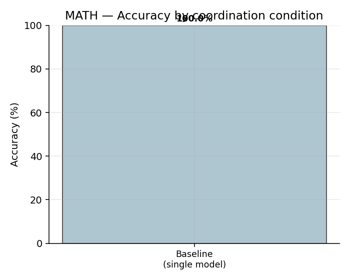
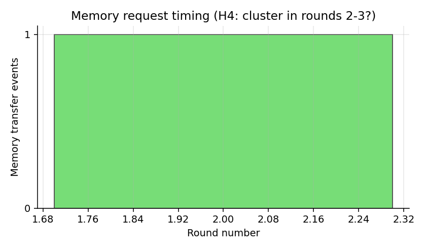

# Multi-Agent Cooperation — Analysis Report

## MATH Results

| Condition | Accuracy | Avg Rounds | Consensus% |
|---|---|---|---|
| Baseline (single model) | 100.0% | 0.0 | 0.0% |

## HotpotQA Results

| Condition | Accuracy | Avg Rounds | Consensus% |
|---|---|---|---|

## Hypothesis Assessment

## Plots

